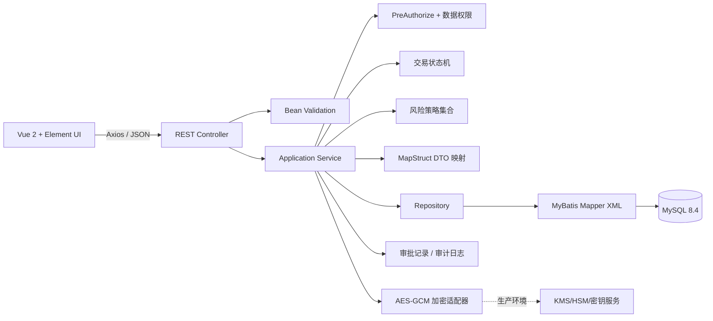
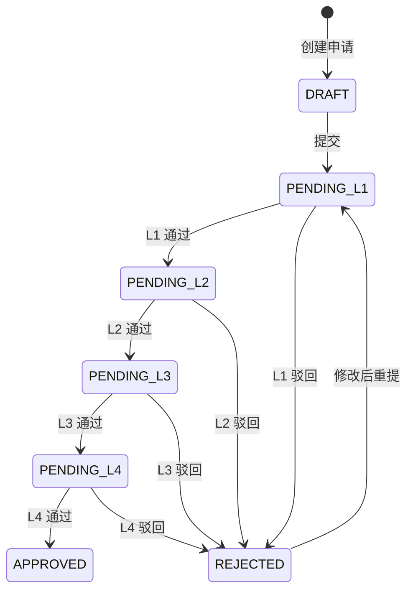

# 架构与教学设计

## 1. 项目目标

本项目用一条完整的银行交易申请链路，演示 Vue 2 前后端分离、Spring Boot 分层、MyBatis XML、参数校验、异常治理、数据权限、敏感字段加密、四级审批、审计和乐观并发控制。它刻意保持业务规模适中，让每个注解和设计模式都能对应到真实问题，而不是为了“凑模式”增加抽象。

> **安全警告：项目用 `X-User-Id`、`X-Role`、`X-Dept-Id` 请求头模拟身份。任何调用方都能伪造这些请求头，因此它只适合本机教学，绝对不能用于生产环境。**

## 2. 逻辑架构



前端只提交业务字段和乐观锁 `version`。身份字段来自教学请求头，申请人、部门、审批人等服务端字段不得接受客户端覆盖。Controller 负责 HTTP 适配，Application Service 负责事务边界，领域对象/状态处理器负责“能否做”，Repository 负责持久化抽象，MyBatis XML 负责“怎样写 SQL”。

## 3. 生命周期与四级审批



核心不变量：

- `DRAFT` 可以提交；本例未提供草稿编辑接口。`REJECTED` 通过完整字段 `resubmit` 命令修改并直接重提。
- `submit` 只允许 `DRAFT -> PENDING_L1`；`resubmit` 只允许 `REJECTED -> PENDING_L1`，两者都重新评分。
- `APPROVER_Ln` 只能处理 `PENDING_Ln`。越级、重复审批和审批自己提交的交易均应拒绝。
- L1–L4 都只看本部门记录、只处理本级待办；D001 四级用户均配置 D001。审计员/管理员跨部门查看，`ALL` 不是通配部门。
- 四级全部通过才进入 `APPROVED`。任一级驳回均进入 `REJECTED`，原因必填。
- `APPROVED` 是终态。生产系统若需要撤销，应增加独立的冲正/撤销流程，而不是修改历史状态。

## 4. 并发与事务

前端每个修改命令必须回传它读到的 `version`，数据库更新采用条件更新：

```sql
UPDATE transaction_application
SET status = ?, current_level = ?, version = version + 1, updated_at = CURRENT_TIMESTAMP(3)
WHERE id = ? AND version = ? AND status = ?;
```

权限首先由方法/所有权/部门检查决定；无权访问返回 403。对有权操作的请求，影响行数为 `0` 表示记录已被其他人处理或状态不再匹配，返回 HTTP `409 Conflict`。旧页面还会在服务层提前检查 version，使重复请求也稳定收到 409；提前检查不能代替 SQL 条件更新。`@Transactional` 保证“主表状态变化 + 审批事实记录 + 审计日志”要么一起提交，要么一起回滚。

条件中同时包含 `version` 和预期 `status`，原因是：版本防止丢失更新，状态条件进一步表达业务前置条件。仅在 Java 中先查再改无法消除竞态。

## 5. 风险评分

风险评分使用 Spring 注入的 `List<RiskStrategy>`：金额策略（满 1 万/10 万/100 万，分别 10/30/55 分）、用途关键词策略（含 博彩/代付/虚拟币/gambling/crypto，加 35 分）、旧 SDK 适配器（收款账户尾号 0000/9999，加 25 分）。总分累加后上限 100。规则固定在代码，不从数据库读取；`@Order` 决定执行顺序。这里只按金额名义值教学，不做汇率换算。

**责任链用于审批资格校验**，不是风险引擎：`状态 → 角色级别 → 部门 → 职责分离`，任一失败就停止。策略负责“如何算”，责任链负责“逐项能否通过”。

| 总分 | 等级 | 教学含义 |
|---:|---|---|
| 0–29 | LOW | 常规交易 |
| 30–69 | MEDIUM | 需要关注 |
| 70–100 | HIGH | 高风险 |

示例评分不是银行真实风控模型，不能用于授信、反洗钱或交易拦截。生产模型需要规则版本、可解释原因、模型验证、误报治理、人工复核和监管留痕。

## 6. 设计模式与注解映射

| 技术/模式 | 解决的问题 | 典型落点 |
|---|---|---|
| `@RestController` | 统一 JSON HTTP 边界 | 交易、审批、审计接口 |
| `@RestControllerAdvice` | 把校验、权限、409 等异常转换为稳定响应 | 全局异常处理器 |
| `@Validated` | 请求体与查询参数的声明式校验 | Controller / command DTO |
| `@ConfigurationProperties` | 类型安全读取加密、认证开关 | BankCryptoProperties / BankSecurityProperties |
| `@Profile` | 隔离开发/测试/生产实现或配置 | RuntimeEnvironment Bean、prod 安全闸、test 数据源 |
| `@ConditionalOnProperty` | 按配置启用某个适配器 | AES-GCM 加密实现 |
| `@Transactional` | 状态、审批、审计原子提交 | Application Service |
| `@PreAuthorize` | 角色级入口保护 | TransactionService 的公开命令/查询方法 |
| 状态模式 | 每个状态明确允许的事件和下一个状态 | submit/approve/reject 状态处理器 |
| 策略模式 | 可插拔风险算法 | AmountRiskStrategy / PurposeKeywordRiskStrategy |
| 责任链 | 按顺序检查审批资格并快速失败 | ApprovalRuleChain |
| 适配器 | 旧 SDK 接口转换为新接口 | LegacyRiskAdapter implements RiskStrategy |
| Repository | 隔离业务与 MyBatis 细节 | TransactionRepository |
| MapStruct | 编译期、类型安全 DTO 映射 | entity -> detail/list response |

## 7. 敏感字段保护

### 7.1 数据格式

手机号、身份证号、付款账号、收款账号进入 Repository 之前用 AES-256-GCM 加密。示例密文为 Base64 编码的 `12-byte IV + ciphertext + 16-byte authentication tag`。每次加密生成新的 CSPRNG 随机 IV；GCM 同时提供机密性和篡改检测。

列表接口默认只返回脱敏值，例如手机号 `138****8000`、账号 `****1234`。是否允许详情解密应按角色、用途、工单和审计进行二次授权，本教学项目只演示基础控制。

### 7.2 查询限制

随机 IV 使相同明文得到不同密文，数据库不能直接对密文做精确匹配或模糊搜索。生产需要按业务选择：

- 精确查询：额外保存带独立密钥的 HMAC-SHA-256 盲索引，并对查询条件同样计算 HMAC。
- 模糊查询：尽量禁止；确有监管需求时用受控的检索服务或分段令牌，评估频率分析泄露。
- 展示：查询后在获授权的应用内解密，再脱敏返回，不能依赖数据库脱敏。

盲索引密钥必须与加密密钥分离；不能用无密钥哈希保存手机号或身份证号，因为其取值空间有限，容易被字典枚举。

## 8. HTTPS、应用层加密与隐私计算

| 能力 | 主要保护对象 | 能防什么 | 不能防什么 | 本项目定位 |
|---|---|---|---|---|
| HTTPS/TLS | 浏览器到网关/服务的传输 | 窃听、传输篡改、伪造服务端 | 数据库/备份泄露，应用进程内明文，拥有查询权的运维 | 所有环境必选；生产强制 TLS 1.2+、HSTS、内部 mTLS |
| 应用层认证加密 | 落库敏感字段 | DBA、只拿到库备份的人直接阅读；密文篡改可检测 | 拿到应用运行权限和解密密钥的人；已授权接口滥用 | 本项目重点，AES-GCM + 外置密钥 |
| 隐私计算 | 跨机构联合计算的数据输入 | 在不直接交换原始数据时做联合统计/建模 | 普通单库 CRUD 的所有安全问题；密钥、终端和结果泄露 | 仅在跨行反欺诈、联合风控等明确场景评估，不是本项目 CRUD 的替代品 |

三者不是互斥选项。TLS 保护“路上”，应用层加密保护“库里”，隐私计算解决“多方协作时尽量不暴露原始输入”。

## 9. 威胁边界

本教学实现可以演示降低以下风险：

- DBA、报表账号或数据库备份读取者只能看到敏感字段密文。
- 非申请人访问其他部门数据时被服务层数据权限拒绝。
- 重复/并发审批由状态条件和 `version` 阻止。
- 关键操作产生审批事实记录和审计记录。

它不声称抵御：

- 应用主机管理员同时读取进程内存、环境变量和数据库；
- 攻击者伪造演示身份请求头；
- 前端 XSS、浏览器插件、用户终端被控后读取解密结果；
- 日志、APM、异常栈或导出任务错误记录敏感明文；
- 内部人员使用合法权限批量查询；
- 供应链投毒、KMS 管理员滥用、流量分析和可用性攻击。

信任边界应至少分为：用户终端、边界网关、业务服务、数据库、密钥系统、日志/监控平台和运维管理面。生产环境中应用与 KMS、数据库、日志平台应使用不同身份和最小权限。

## 10. 生产加固清单

1. 以银行统一 IAM/OIDC/OAuth2、短期令牌和服务端会话替换所有演示请求头；网关剥离外部同名头。
2. 用 Spring Security Resource Server 校验签发者、受众、过期时间、签名和权限；高风险审批启用 MFA/交易签名。
3. 密钥放入 HSM/KMS/Vault，使用信封加密、密钥版本和定期轮换；应用配置不保存明文密钥。
4. 分离 DB、KMS、部署和审计管理员权限，关键操作双人复核；建设 break-glass 流程。
5. 全链路 TLS，服务间 mTLS；数据库和备份启用存储加密，并验证恢复演练。
6. 审计日志只追加，实时送往独立 SIEM/WORM 存储；记录查询目的、授权依据和 trace id，禁止敏感明文。
7. API 增加速率限制、幂等键、CSRF/CORS 精确策略、内容安全策略、参数大小限制和导出水印。
8. 对批量查询、异常时间/来源、权限提升和解密量设置告警；对敏感读取采用列级授权和二次审批。
9. 使用 Flyway/Liquibase 管理数据库版本，不在生产自动执行 `schema.sql` 或授予 DDL 权限。
10. 建立 SAST/SCA/密钥扫描、镜像签名、SBOM、渗透测试、灾备演练和监管合规评审。

